# SecAudit 2.0 Enterprise (SPPS)

Security analysis and vulnerability auditing platform for source code, dependencies, cloud infrastructure, and live HTTP services.

[](https://python.org)
[](LICENSE)
[](https://owasp.org)
[](https://sarifweb.azurewebsites.net/)
[]()

---

## Overview

SecAudit 2.0 is a multi-threaded security auditor that unifies four security pillars into a single engine:

1. **SAST & Secrets**: Static code analysis for injection flaws, authentication errors, logic bugs, and high-entropy secret detection.
2. **SCA & Supply Chain**: Dependency vulnerability lookup against Google OSV.dev across 7 ecosystems, lockfile precedence parsing, and license compliance verification.
3. **IaC & Cloud Infrastructure**: Configuration audits for Dockerfiles, Docker Compose, Kubernetes manifests, and Terraform files (`.tf`, `.tfvars`).
4. **DAST & Attack Surface**: Dynamic scanning of live web endpoints, security headers, deep CSP policies, SSL/TLS certificates, DNS security records (SPF, DMARC, CAA), GraphQL endpoints, and WebSocket connections.

Includes both a CLI tool (`main.py`) and a PyQt6 Desktop Studio (`gui.py`).

---

## Architecture

```mermaid
flowchart TD
    Input["Input: Source Directory / Target URL"] --> Orch["SecAudit Multi-threaded Orchestrator"]

    subgraph SAST_Pillar["1. SAST & Secrets Engine"]
        Orch --> SAST["sast_scanner.py (AST & Regex Sinks)"]
        Orch --> JWT["jwt_scanner.py (Algorithm & Secret Audit)"]
        Orch --> WS["websocket_scanner.py (ws:// & CSWSH Checks)"]
    end

    subgraph SCA_Pillar["2. Supply Chain & SCA"]
        Orch --> SCA["sca_scanner.py (Lockfile Precedence & OSV.dev API)"]
        Orch --> LIC["license_scanner.py (Copyleft & License Classification)"]
    end

    subgraph IaC_Pillar["3. Infrastructure as Code (IaC)"]
        Orch --> IaC_Dock["iac_scanner.py (Dockerfile & Compose Audits)"]
        Orch --> IaC_K8s["iac_scanner.py (Kubernetes SecurityContext)"]
        Orch --> IaC_TF["iac_scanner.py (Terraform Security Groups, S3, IAM)"]
        Orch --> CICD["cicd_scanner.py (GitHub Actions PwnRequest & Workflows)"]
    end

    subgraph DAST_Pillar["4. DAST & Attack Surface"]
        Orch --> DAST_Head["header_scanner.py & csp_evaluator.py"]
        Orch --> DAST_SSL["ssl_scanner.py (X.509 Cryptography Extraction)"]
        Orch --> DAST_DNS["dns_scanner.py (DoH DNS, SPF, DMARC, CAA)"]
        Orch --> DAST_GQL["graphql_scanner.py (Introspection & Suggestions)"]
        Orch --> DAST_Tech["tech_detector.py & sensitive_files_scanner.py"]
        Orch --> DAST_API["api_spec_scanner.py (OpenAPI / Swagger Specs)"]
    end

    SAST_Pillar --> Engine["Volume-Weighted Scoring Engine (models.py)"]
    SCA_Pillar --> Engine
    IaC_Pillar --> Engine
    DAST_Pillar --> Engine

    Engine --> Out_CLI["Terminal Console (Rich Tables)"]
    Engine --> Out_GUI["PyQt6 Studio GUI"]
    Engine --> Out_HTML["HTML Dashboard"]
    Engine --> Out_SARIF["SARIF v2.1.0 (GitHub Code Scanning)"]
    Engine --> Out_JSON["JSON & Markdown Reports"]
```



---

## Scanner Engines

### 1. Static Application Security Testing (SAST)
- **Secret Detection**: OpenAI (`sk-...`), Stripe live keys, Telegram bot tokens, Slack webhooks, GitHub Personal Access Tokens, AWS keys, private RSA/SSH keys, and database URIs.
- **Shannon Entropy Filter**: Suppresses dummy placeholders (`ghp_xxxx`, repeated strings) with entropy $H < 2.5$.
- **Injection Flaws**: SQL injection via string concatenation, command injection (`os.system`, `child_process.exec`), dynamic code execution (`eval`, `exec`), and insecure deserialization (`pickle.loads`, `unserialize`).
- **Web Vulnerabilities**: Prototype pollution assignment sinks, SSRF with static origin lookback validation, path traversal with confinement checks, and frontend DOM XSS (`dangerouslySetInnerHTML`, `v-html`).

### 2. Software Composition Analysis (SCA) & Licenses
- **Supported Ecosystems**: npm/Yarn, Python (pip/Poetry), PHP (Composer), Rust (Cargo), Go modules.
- **Lockfile Precedence**: Reads lockfiles (`package-lock.json`, `poetry.lock`, `composer.lock`, `Cargo.lock`) first to avoid manifest range discrepancies.
- **OSV.dev API**: Two-phase concurrent hydration querying Google OSV database with alias deduplication (`GHSA` and `CVE`).
- **License Compliance**: Flags copyleft licenses (AGPL-3.0, GPL-3.0) and lists license distributions.

### 3. Infrastructure as Code (IaC) & CI/CD
- **Docker**: Flags root user execution, unpinned `:latest` tags, and plaintext `ENV` credentials.
- **Docker Compose**: Flags `privileged: true` containers and exposed internal database ports.
- **Kubernetes**: Audits `securityContext` for privileged pods, `allowPrivilegeEscalation: true`, and dangerous `hostPath` mounts.
- **Terraform**: Detects `0.0.0.0/0` ingress on sensitive ports (SSH 22, RDP 3389, DB ports), public S3 bucket ACLs, unencrypted EBS/RDS volumes, and hardcoded provider credentials.
- **CI/CD Pipelines**: Detects GitHub Actions `pull_request_target` checkout execution (PwnRequest), untrusted expression script injections (`${{ github.event... }}`), and unpinned action tags.

### 4. Dynamic Application Security Testing (DAST)
- **Security Headers & CSP**: Validates HSTS, CSP, X-Frame-Options, X-Content-Type-Options, Referrer-Policy, and Permissions-Policy. Evaluates CSP for `unsafe-inline`, `unsafe-eval`, and missing frame confinement.
- **SSL/TLS Audit**: Extracts certificate validity, expiration dates, cryptographic signature algorithms, and TLS protocol versions.
- **DNS & Mail Security**: Queries SPF, DMARC, and CAA records via DNS-over-HTTPS (DoH).
- **GraphQL Security**: Probes endpoints for public introspection schemas, field suggestion disclosures, and cyclic query bomb vulnerabilities.
- **WebSocket Transport**: Flags cleartext `ws://` connections and server configurations lacking Origin verification (CSWSH risk).
- **Sensitive Files & Tech Stack**: Probes for exposed `.env`, `.git/HEAD`, `docker-compose.yml`, server configs, and identifies runtime frameworks.

---

## Installation

### Requirements
- Python 3.10 or higher
- Git

```bash
# Clone the repository
git clone https://github.com/parsa2Cj/SPPS.git
cd SPPS

# Create and activate virtual environment
python -m venv venv

# On Linux / macOS:
source venv/bin/activate
# On Windows:
venv\Scripts\activate

# Install dependencies
pip install -r requirements.txt
```

---

## Usage

### 1. PyQt6 Desktop GUI Studio

Launch the desktop interface:

```bash
python gui.py
```

Features:
- Non-blocking execution thread with pause and cancel controls.
- Live scan progress with per-scanner task heartbeat.
- Directory and URL pickers.
- Interactive findings table with severity filters and text search.
- Proof of Concept (PoC) viewer with one-click curl copy to clipboard.
- Report export buttons (HTML, SARIF, Markdown, JSON).

### 2. Command Line Interface (CLI)

#### Interactive Wizard
Run without parameters to enter guided CLI mode:
```bash
python main.py
```

#### Scan a Live Website (DAST)
```bash
python main.py --url https://example.com
```

#### Scan a Local Codebase (SAST, SCA, IaC)
```bash
python main.py --dir .
```

#### Full Enterprise Audit (DAST + SAST + SCA + IaC)
```bash
python main.py --url https://example.com --dir . --html reports/audit.html --sarif reports/audit.sarif --json reports/audit.json
```

#### Git Diff Scan (Changed Files Only)
```bash
python main.py --dir . --diff
```

---

## CLI Options

| Option | Description | Example |
| :--- | :--- | :--- |
| `-u`, `--url` | Target URL for dynamic analysis (DAST) | `--url https://example.com` |
| `-d`, `--dir` | Target directory for static analysis (SAST, IaC, SCA) | `--dir .` |
| `--diff` | Scan only files modified in git working tree | `--diff` |
| `--html` | Export path for interactive HTML dashboard | `--html reports/audit.html` |
| `--json` | Export path for structured JSON findings | `--json reports/audit.json` |
| `--sarif` | Export path for OASIS SARIF v2.1.0 report | `--sarif reports/audit.sarif` |
| `--md` | Export path for Markdown audit report | `--md reports/audit.md` |
| `--threads` | Worker threads for parallel scans (default: 6) | `--threads 8` |
| `--timeout` | HTTP network timeout in seconds (default: 10) | `--timeout 15` |
| `--offline` | Run offline without querying remote vulnerability databases | `--offline` |
| `--no-browser`| Do not automatically open HTML report in default browser | `--no-browser` |

---

## Scoring Methodology

SecAudit computes a security score from 0 to 100 based on four volume-weighted sub-pillars:

$$\text{Final Score} = \min\left(\text{Pillar Composite}, \text{Asymptotic Ceiling}\right)$$

1. **Volume Weighting**: Finding penalties are normalized by codebase scale (KLoC, audited files, total packages, endpoints) using clustered defect caps to prevent repetitive findings in one file from disproportionately distorting the score.
2. **Smooth Asymptotic Ceiling**: If high-severity findings exist without critical findings, the score decays continuously rather than dropping in step-function cliffs:
   $$\text{Ceiling} = 100 - 30 \times (1 - e^{-0.06 \times H})$$
3. **Critical Guardrails**: Critical findings strictly constrain the maximum attainable score:
   - 1 Critical flaw $\to$ Score capped at 69 (Grade C)
   - 2 Critical flaws $\to$ Score capped at 49 (Grade D)
   - 4+ Critical flaws $\to$ Score capped at 29 (Grade F)

---

## CI/CD Integration

To run automated security audits on GitHub pull requests and push events, add `.github/workflows/security.yml`:

```yaml
name: SecAudit Security Pipeline

on: [push, pull_request]

jobs:
  audit:
    runs-on: ubuntu-latest
    steps:
      - name: Checkout Code
        uses: actions/checkout@v4

      - name: Set up Python
        uses: actions/setup-python@v5
        with:
          python-version: "3.11"

      - name: Install Dependencies
        run: |
          pip install -r requirements.txt

      - name: Run SecAudit
        run: |
          python main.py --dir . --sarif audit.sarif --no-browser

      - name: Upload SARIF to GitHub Security Tab
        uses: github/codeql-action/upload-sarif@v3
        if: always()
        with:
          sarif_file: audit.sarif
```

---

## Project Structure

```text
SPPS/
├── gui.py                         # GUI launcher entrypoint
├── main.py                        # CLI launcher entrypoint
├── requirements.txt               # Project dependencies
├── README.md                      # Documentation
├── sec_audit/
│   ├── config.py                  # Scanner configuration, signatures, and patterns
│   ├── gui.py                     # PyQt6 Desktop Studio application
│   ├── ignore_matcher.py          # .gitignore parser and exclusion filter
│   ├── models.py                  # Data models, Severity enums, and Scoring Engine
│   ├── orchestrator.py            # Multi-threaded execution coordinator
│   ├── remediation/
│   │   └── fix_generator.py       # Configuration fix generator (Nginx, Apache, ...)
│   ├── reporting/
│   │   ├── html_reporter.py       # HTML report generator
│   │   ├── json_reporter.py       # JSON report generator
│   │   ├── markdown_reporter.py   # Markdown report generator
│   │   ├── sarif_reporter.py      # OASIS SARIF v2.1.0 generator
│   │   ├── terminal_reporter.py   # Rich terminal output generator
│   │   └── templates/
│   │       └── report_template.html # HTML dashboard template
│   └── scanners/
│       ├── api_spec_scanner.py    # OpenAPI / Swagger specification auditor
│       ├── cicd_scanner.py        # GitHub Actions & GitLab CI pipeline auditor
│       ├── cors_methods_scanner.py# HTTP methods & CORS origin reflection checks
│       ├── csp_evaluator.py       # Content Security Policy analyzer
│       ├── dns_scanner.py         # DNS-over-HTTPS, SPF, DMARC, CAA auditor
│       ├── graphql_scanner.py     # GraphQL introspection & query depth auditor
│       ├── header_scanner.py      # HTTP security headers analyzer
│       ├── iac_scanner.py         # Dockerfile, Compose, K8s, and Terraform auditor
│       ├── jwt_scanner.py         # JWT algorithm and secret auditor
│       ├── license_scanner.py     # Software license compliance auditor
│       ├── nosqli_scanner.py      # NoSQL injection & MongoDB query auditor
│       ├── sast_scanner.py        # Static code analysis & secret scanner
│       ├── sca_scanner.py         # Software composition analysis (OSV.dev API)
│       ├── sensitive_files_scanner.py # Exposed sensitive file probe
│       ├── ssl_scanner.py         # SSL/TLS certificate validator
│       ├── ssti_scanner.py        # Server-Side Template Injection auditor
│       ├── tech_detector.py       # Server & framework signature detector
│       ├── websocket_scanner.py   # WebSocket transport & CSWSH auditor
│       └── xxe_scanner.py         # XML External Entity (XXE) parser auditor
└── tests/
    └── test_audit.py              # Automated test suite
```

---

## Testing

Run the automated test suite:

```bash
python -m unittest discover tests
```

---

## License

This project is licensed under the [MIT License](LICENSE).
